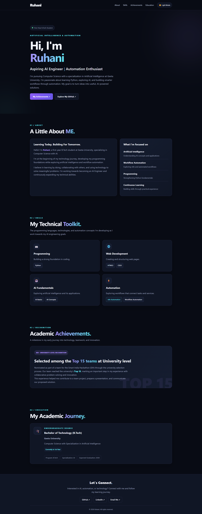

# Ruhani's Portfolio

A single-page portfolio website built with HTML, CSS and JavaScript by Ruhani.

**Live site:** https://ruhani.niat.tech
**Resume:** [View My Resume](./resume.pdf)

## What's inside
- About, skills, education and projects sections
- Dark mode toggle
- Responsive on mobile and desktop

## Run it locally
1. Download or clone this repo
2. Open index.html in your browser

## Screenshot

## What I learned
I learned how to organise a portfolio website and present my information clearly.
I practised using GitHub to store and manage project files.
I learned how to include images and a resume in a repository.
